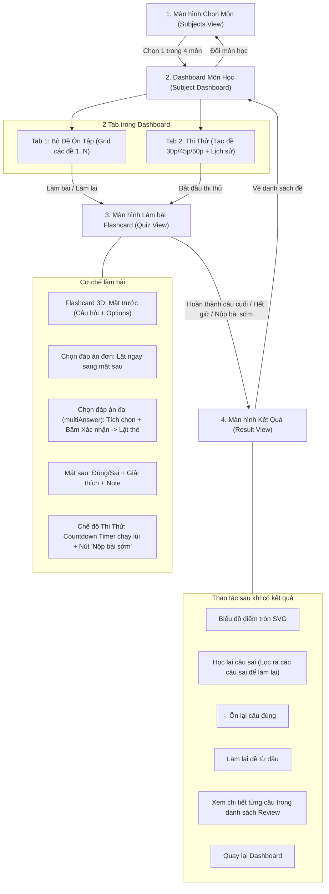

# 🗺️ MIGRATION PLAN: HTML/CSS/JS thuần sang React + Vite + Chakra UI

> **Nhánh làm việc:** `feat/migrate-react-ui`  
> **Nguyên tắc cốt lõi:** Tuân thủ 100% `PROJECT_RULES.md` — Bảo toàn trọn vẹn nghiệp vụ/dữ liệu gốc; thay đổi giao diện theo chuẩn Design System `_reference_ui`; thiết kế tầng Mock Service async chuẩn bị sẵn cho Backend tương lai.

---

## 📌 GIAI ĐOẠN 0: KẾT QUẢ KHẢO SÁT HỆ THỐNG

### 1. Khảo Sát Dự Án Hiện Tại (Source of Truth)

#### 1.1. Bản Đồ Môn Học & Ngân Hàng Câu Hỏi
Hệ thống hiện tại gồm **4 môn học độc lập** với tổng cộng **1.837 câu hỏi**:
1. **MLN111 (Triết học Mác - Lênin):** 598 câu hỏi • 12 bộ đề (50 câu/đề, đề 12 có 48 câu) • File: `questions.js`
2. **MLN122 (Kinh tế chính trị Mác - Lênin):** 538 câu hỏi • 11 bộ đề (50 câu/đề, đề 11 có 38 câu) • File: `data_mln122.js`
3. **AET (Aesthetics & Art Theory):** 234 câu hỏi • 5 bộ đề (50 câu/đề, đề 5 có 34 câu) • File: `data_aet.js`
4. **HOD (History of Design):** 467 câu hỏi • 10 bộ đề (50 câu/đề, đề 10 có 17 câu) • File: `data_hod.js`

#### 1.2. Cấu Trúc Dữ Liệu (Data Schemas)
- **Câu hỏi (`IQuestion`):**
  ```typescript
  interface IQuestion {
    id: number;
    question: string;
    options: string[];          // ["A. ...", "B. ...", "C. ...", "D. ..."]
    answer: string | string[];  // "B" hoặc ["A", "D", "E"] đối với câu multiAnswer
    multiAnswer?: boolean;      // true nếu là câu hỏi chọn nhiều đáp án (phổ biến ở HOD)
    note?: string;              // Ghi chú hoặc lời giải thích thêm nếu có
  }
  ```
- **Tiến độ ôn tập theo bộ đề (`ISubjectProgress`):**
  Lưu trong `localStorage` với key: `<subjectCode>_quizlet_progress_v2`
  ```typescript
  interface IExamProgress {
    score: number;
    total: number;
    isCompleted: boolean;
    completedAt?: number;
    answers: Record<number, {
      selected: string | string[];
      correct: boolean;
    }>;
  }
  type ISubjectProgress = Record<number, IExamProgress>; // key là examNumber (1..N)
  ```
- **Lịch sử thi thử (`IMockExam`):**
  Lưu trong `localStorage` với key: `<subjectCode>_mock_exam_progress_v2`
  ```typescript
  interface IMockExam {
    id: string;               // "mock_1700000000"
    examNumber: number;       // 1, 2, 3...
    title: string;            // "Đề thi thử #1"
    durationMinutes: number;  // 30 | 45 | 50
    createdAt: number;
    updatedAt: number;
    questions: IQuestion[];   // 50 câu bốc ngẫu nhiên
    answers: Record<number, { selected: string | string[]; correct: boolean }>;
    lastScore: number;
    total: number;
    isCompleted: boolean;
  }
  ```

#### 1.3. Sơ Đồ Luồng Hoạt Động (User Flows)


---

### 2. Khảo Sát Tài Nguyên Tái Sử Dụng Từ `_reference_ui`

| Loại tài nguyên | Nguồn trong `_reference_ui` | Kế hoạch tái sử dụng cho dự án mới |
| :--- | :--- | :--- |
| **Theme & Màu sắc** | `src/themes/defaut-theme.ts` & `dark-theme.ts` | Tái sử dụng bảng màu: `#283191` (Navy), `#3D59D6` (Exam Card), `#98FD1D` (Success), `#FF4249` (Error), Font `Nunito`, button styles. |
| **Hình nền & Card UI** | `src/assets/images/` | `bg-main.png`, `card-1.png` - `card-4.png` (dùng làm thumbnail đại diện cho 4 môn), `SP_Score_Icon.png`, `SP_Time_Icon.png`, `ic-true.png`, `ic-false.png`. |
| **Icon Vector (SVG)** | `src/assets/svgs/` | `IcSetting`, `IcVolume`, `IcHamburger`, `IcCup`, `IcUser`, `IcBin`, `IcShuffle`... |
| **Settings Modal** | `src/pages/layout/components/setting/` | Tái sử dụng nguyên bản cấu trúc thanh trượt âm lượng (Master, Music, SFX) với giao diện kính tối mờ `#283191`. |
| **Hệ thống Âm thanh** | Tích hợp Web Audio API / Audio hooks | Tạo `SoundContext` chuẩn để phát: BGM (nhạc nền), tiếng lật thẻ (Flip), tiếng chọn đúng (Correct), tiếng chọn sai (Wrong), tiếng đếm giờ (Tick) và tiếng hoàn thành bài thi (Victory). |
| **Animation & Motion** | `framer-motion` | Tái sử dụng các hiệu ứng fade-in, hover scale, 3D card flip và banner animation. |

---

## 🚀 KẾ HOẠCH MIGRATION CHI TIẾT (5 PHASES)

### Phase 1: Khởi tạo nền tảng & Design System
- [x] Khởi tạo dự án React + TypeScript + Vite tại thư mục gốc.
- [x] Cài đặt các thư viện lõi tương thích:
  - `@chakra-ui/react` (v2), `@emotion/react`, `@emotion/styled`, `framer-motion`
  - `react-icons`, `@chakra-ui/icons`
  - `canvas-confetti` (cho hiệu ứng đạt điểm cao)
- [x] Cấu hình `vite.config.ts` (alias `@/`, `@assets/`, `@components/`, `@services/`, `@themes/`).
- [x] Sao chép và tổ chức lại assets từ `_reference_ui/src/assets` (hình ảnh, icons SVG, âm thanh).
- [x] Thiết lập Chakra UI Theme (`src/themes/theme.ts`) đồng bộ với `_reference_ui` (font Nunito, màu sắc, breakpoints).
- [x] Xây dựng `SoundContext` & `SoundManager` hỗ trợ BGM, SFX (click, flip, correct, wrong, timeout, victory).
- [x] Tích hợp `SettingsModal` từ `_reference_ui` vào Header chung.

### Phase 2: Xây dựng Tầng Mock Service & Quản Lý Dữ Liệu
- [x] Chuẩn hoá 4 file dữ liệu câu hỏi thành TypeScript modules trong `src/data/`:
  - `mln111.data.ts` (598 câu)
  - `mln122.data.ts` (538 câu)
  - `aet.data.ts` (234 câu)
  - `hod.data.ts` (467 câu)
- [x] Thiết kế `src/services/` theo chuẩn Service/Repository Pattern:
  - `quizService.ts`:
    - `getSubjects(): Promise<ISubject[]>`
    - `getSubjectDetail(code): Promise<ISubjectDetail>`
    - `getExamQuestions(subjectCode, examNumber): Promise<IQuestion[]>`
    - `generateMockExam(subjectCode, count, duration): Promise<IMockExam>`
  - `progressService.ts`:
    - `getSubjectProgress(subjectCode): Promise<ISubjectProgress>`
    - `saveExamProgress(subjectCode, examNum, answers, isCompleted): Promise<void>`
    - `getMockExams(subjectCode): Promise<IMockExam[]>`
    - `saveMockExam(subjectCode, mock): Promise<void>`
    - `deleteMockExam(subjectCode, mockId): Promise<void>`
  - `settingsService.ts`:
    - `getSettings(): ISettings`
    - `saveSettings(settings: ISettings): void`
  - `migrationService.ts`:
    - Tự động nhận diện và chuyển dữ liệu `localStorage` cũ (từ phiên bản HTML thuần) sang cấu trúc mới, đảm bảo người dùng không bị mất tiến độ làm bài cũ.
- [x] Viết unit/sanity test cho Service Layer để đảm bảo trả về đúng dữ liệu giả lập.

### Phase 3: Chuyển đổi Giao Diện & Màn Hình Nghiệp Vụ
- [x] **Màn hình 1: Danh Sách Môn Học (`SubjectsPage`)**:
  - Giao diện Header với Logo, nút Cài đặt âm thanh (Settings), trạng thái tổng.
  - Lưới 4 Card Môn Học lấy cảm hứng từ `ModeCard` (`card-1` -> `card-4`) của `_reference_ui`.
  - Hiển thị thanh tiến độ, số bộ đề đã học / tổng số đề, số lượng câu hỏi.
- [x] **Màn hình 2: Dashboard Môn Học (`SubjectDashboardPage`)**:
  - Nút quay lại ("Chọn môn"), chuyển đổi môn nhanh.
  - Tab 1: **Bộ Đề Ôn Tập**: Grid danh sách bộ đề (Bộ đề 1..N), hiển thị tỷ lệ %, điểm số, trạng thái (Chưa học / Đang học / Đã xong), nút Làm bài / Làm lại.
  - Tab 2: **Thi Thử**:
    - Card Tạo đề mới với bộ chọn thời gian: `30 phút (Tryhard)`, `45 phút (Tiêu chuẩn)`, `50 phút (Thoải mái)` (không chứa emoji theo yêu cầu).
    - Danh sách đề thi thử đã làm: Xem lại, Làm lại, Học lại câu sai, Xoá đề thi.
- [x] **Màn hình 3: Làm Bài & Flashcard 3D (`QuizPage`)**:
  - Header bài thi: Tên bộ đề, đồng hồ đếm ngược (nếu là thi thử, có hiệu ứng đổi màu khi gần hết giờ), số câu hiện tại (`Câu X/50`), thanh Progress bar.
  - Flashcard tương tác 3D:
    - Mặt trước: Câu hỏi, các nút chọn A/B/C/D/E.
    - Hỗ trợ câu đơn: Chọn là lật thẻ ngay.
    - Hỗ trợ câu đa đáp án (`multiAnswer`): Checkbox chọn nhiều đáp án + Nút "Xác nhận câu trả lời".
    - Mặt sau: Nhãn Đúng/Sai, đáp án bạn chọn vs đáp án đúng, giải thích / ghi chú.
  - Nút "Câu tiếp theo" và nút "Nộp bài sớm" (cho thi thử).
- [x] **Màn hình 4: Kết Quả & Ôn Tập Chuyên Sâu (`ResultPage`)**:
  - Biểu đồ điểm tròn SVG với dải màu gradient từ theme `_reference_ui`.
  - Thống kê: Đúng, Sai, Tỷ lệ %, Thời gian làm bài (nếu thi thử).
  - Pháo hoa chúc mừng (`canvas-confetti`) nếu đạt từ 80% điểm trở lên.
  - Các chế độ ôn tập:
    - "Học lại câu sai" (lọc chính xác danh sách câu làm sai).
    - "Ôn lại câu đúng".
    - "Làm lại đề thi này".
    - "Về danh sách đề".
  - Danh sách Review chi tiết từng câu hỏi bên dưới.

### Phase 4: Tích hợp Âm Thanh, Hiệu Ứng Chuyển Động & Settings
- [x] Gắn SFX vào các hành vi người dùng:
  - Click chọn đáp án / bấm nút menu.
  - Lật thẻ Flashcard (tiếng flip mềm mại).
  - Trả lời đúng (âm thanh chúc mừng ngắn).
  - Trả lời sai (âm thanh báo lỗi êm tai).
  - Đếm ngược 5 giây cuối (tiếng tick đồng hồ).
  - Hoàn thành bài thi (âm thanh chiến thắng / kết thúc).
- [x] Nhạc nền BGM nhẹ nhàng (tùy chỉnh bật/tắt và âm lượng trong Settings).
- [x] Đồng bộ Settings với `localStorage` qua `settingsService`.

### Phase 5: Kiểm Thử Toàn Diện & Chuẩn Bị Deploy Vercel
- [x] Kiểm thử toàn diện 100% các luồng người dùng trên cả 4 môn (MLN111, MLN122, AET, HOD).
- [x] Kiểm thử responsive trên Mobile, Tablet và Desktop.
- [x] Kiểm tra tính toàn vẹn của dữ liệu cũ trong `localStorage` sau migration.
- [x] Kiểm tra lệnh build sản phẩm: `npm run build` (không có lỗi TypeScript hay Vite bundler).
- [x] Tạo file cấu hình `vercel.json` hỗ trợ Clean URL và SPA Routing.

---

## 📊 TIẾN ĐỘ THỰC HIỆN
- [x] **Giai đoạn 0: Khảo sát & Lập Kế hoạch Migration** *(Đã hoàn thành)*
- [x] **Phase 1: Khởi tạo nền tảng & Design System** *(Đã hoàn thành: Setup Vite + React 19 + Chakra UI, theme & assets Olympia, Web Audio SoundContext, SettingsModal)*
- [x] **Phase 2: Xây dựng Mock Service Layer & Migration Dữ liệu** *(Đã hoàn thành: 4 datasets TS 1837 câu, Repository pattern quizService & progressService, auto migration v1->v2)*
- [x] **Phase 3: Chuyển đổi Màn hình & Luồng nghiệp vụ** *(Đã hoàn thành: SubjectsPage, SubjectDashboardPage với tab Ôn tập & Thi thử, QuizPage Flashcard 3D single/multi-choice, ResultPage score circle SVG & review)*
- [x] **Phase 4: Tích hợp Âm thanh, Motion & Bảng Settings** *(Đã hoàn thành: SFX flip/click/correct/wrong/tick/victory, Ambient BGM, Settings modal glassmorphism)*
- [x] **Phase 5: Kiểm thử luồng & Cấu hình Deploy Vercel** *(Đã hoàn thành: vercel.json rewrite SPA, build production thành công 0 lỗi)*
